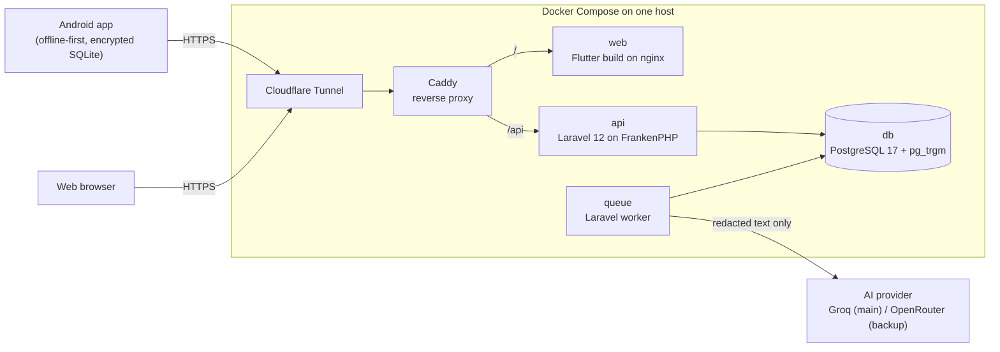

# Anecnotes

AI-assisted anecdotal records and attendance for Valencia National High School, on the web and offline-first Android.

**Live URL:** _not deployed yet (M3)_ · **API docs:** _/api/docs once deployed_
**Section:** BSIT 4Cx · **Adviser/Instructor:** Rinante M. Buntod
**Team:** Ethan H. Campomanes — sole developer (all roles)

## Features (by role)

- **Adviser/Teacher:** seat-plan roll call (online or offline) with a 15-minute correction window; write anecdotes in 5 taps or fewer; see AI-suggested category and severity, labeled as machine-generated; SF2 export.
- **Guidance:** all sections; confirm or dismiss AI repeated-behavior flags; AI summaries of a student's anecdotes; resolve anecdotes.
- **Admin:** SF1 import, sections, seat plans and accounts; correct attendance after the window; delete records; audit log.

## Architecture



The API saves records and returns at once; the queue worker runs AI analysis and repeated-behavior detection in the background, so an AI outage never blocks a teacher. Design documents: [docs/](docs/README.md).

## Tech stack

| Layer | Technology |
|---|---|
| Client | Flutter 3.47 (web + Android, offline-first with encrypted SQLite) |
| API | Laravel 12, Sanctum, Scramble (OpenAPI), Laravel Excel |
| Database | PostgreSQL 17 + pg_trgm |
| AI | OpenAI-compatible client: Groq (demo), OpenRouter (backup), llama.cpp/Ollama (real use) |
| DevOps | Docker Compose, Caddy, Cloudflare Tunnel, GitHub Actions (self-hosted runner) |
| Tests | Pest, Larastan, Pint, `flutter test` |

## Run locally

```bash
git clone <repo-url> && cd itsd85-final-bsit4cx-anecnotes
cp .env.example .env        # then set APP_KEY, DB_PASSWORD and the AI keys
docker compose up -d --build
```

- App: <http://localhost:8080>
- Health: <http://localhost:8080/api/health>
- API docs: <http://localhost:8080/api/docs>

The port is `HTTP_PORT` in `.env` (default 8080); use your port in the links above if you changed it.

Android on a USB-connected phone: `adb reverse tcp:8080 tcp:8080`, then `cd frontend && flutter run`.
Over Wi-Fi instead: allow the port in Windows Firewall (private networks), then
`flutter run --dart-define=API_BASE_URL=http://<laptop-ip>:<HTTP_PORT>/api/v1`.

## Test

```bash
# backend
cd backend && composer install && vendor/bin/pint --test && vendor/bin/phpstan analyse && vendor/bin/pest
# frontend
cd frontend && flutter analyze && flutter test
```

## Deployment

GitHub Actions (`.github/workflows/ci-cd.yml`) runs the `backend` and `frontend` checks on every pull request. On merge to `main`, a self-hosted runner on the server rebuilds with `docker compose up -d --build` and checks that `/api/health` reports the new commit. Public HTTPS uses Cloudflare Tunnel (hosting option A). Details: [docs/deployment.md](docs/deployment.md).

## Demo accounts

Sample data only (fictional students; LRNs start with `9999`). The password is the server's `DEMO_PASSWORD`, given to the panel separately.

| Role | Email |
|---|---|
| Admin | `admin@demo.anecnotes.test` |
| Adviser (8-Rizal) | `adviser@demo.anecnotes.test` |
| Teacher | `teacher@demo.anecnotes.test` |
| Guidance | `guidance@demo.anecnotes.test` |

## Documentation

M2 design drafts: [user stories](docs/01-system-documentation/design/user-stories.md) · [ERD](docs/01-system-documentation/design/erd.md) · [wireframes](docs/01-system-documentation/design/wireframes.md) · [integration design](docs/01-system-documentation/design/integration-design.md) · [draft OpenAPI](docs/03-api/openapi.yaml).
D1–D4 PDFs will be linked here.

## License and credits

_To be added._ AI tools used during development are declared in the Acknowledgment of D1 and D4 (§13).
