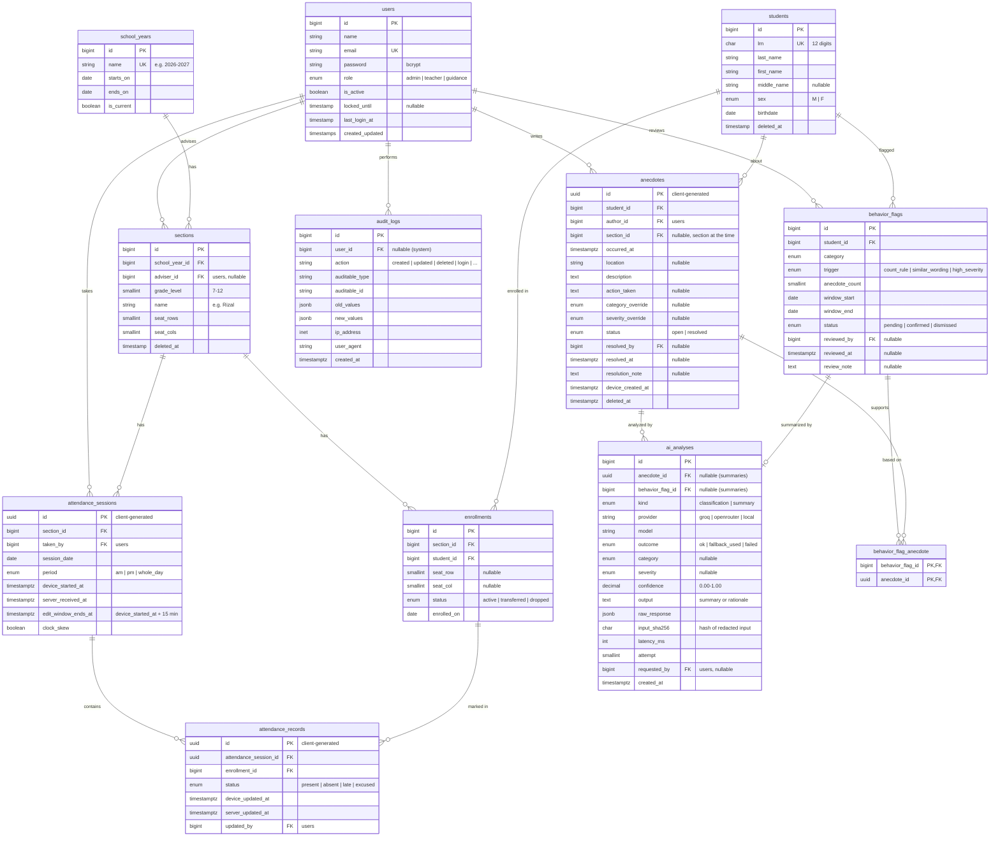

# ERD and Data Dictionary

**System:** Anecnotes · **Milestone:** M2 (Design) · **Status:** draft, 2026-11-23
**Database:** PostgreSQL 17 with the `pg_trgm` extension. All tables are created by Laravel migrations (D1).

## Entity-relationship diagram

Laravel framework tables (`personal_access_tokens`, `jobs`, `failed_jobs`, `cache`, `sessions`) are not drawn.

## Relationships in words

- A **school year** has many **sections**; each section has at most one **adviser** (a user with role `teacher`).
- A **student** is placed in a section through an **enrollment**, which also holds the seat. A student keeps their enrollments from earlier years.
- An **attendance session** is one roll call for one section, date and period. It contains one **attendance record** per enrolled student.
- An **anecdote** is about one student and written by one teacher. It has zero or more **AI analyses** (re-analysis after an edit adds a row; the newest `ok` row is current).
- A **behavior flag** groups the anecdotes behind it through `behavior_flag_anecdote` and may have one AI summary (an `ai_analyses` row of kind `summary`).
- The **audit log** records changes to anecdotes, attendance after the first save, flags, accounts and every AI call.

## Enumerations

| Name | Values |
|---|---|
| `role` | `admin`, `teacher`, `guidance` |
| `category` | `attendance_tardiness`, `disruptive_behavior`, `defiance_disrespect`, `aggression_bullying`, `academic_concern`, `wellbeing_concern`, `positive_behavior`, `other` |
| `severity` | `low`, `medium`, `high` |
| `attendance status` | `present`, `absent`, `late`, `excused` |

`positive_behavior` anecdotes never count toward a flag.

## Data dictionary

Types are PostgreSQL types. **PK** primary key, **FK** foreign key, **UK** unique, **NN** not null.

### users
| Column | Type | Constraints | Description |
|---|---|---|---|
| id | bigint | PK | |
| name | varchar(120) | NN | Display name |
| email | varchar(190) | NN, UK | Login, lower-cased |
| password | varchar(255) | NN | bcrypt hash, never returned by the API |
| role | varchar(16) | NN, check in enum | `admin`, `teacher` or `guidance` |
| is_active | boolean | NN, default true | Deactivated users cannot sign in |
| locked_until | timestamptz | | Temporary lock set by an admin |
| last_login_at | timestamptz | | |
| created_at, updated_at | timestamptz | | |

### school_years
| Column | Type | Constraints | Description |
|---|---|---|---|
| id | bigint | PK | |
| name | varchar(9) | NN, UK | `2026-2027` |
| starts_on, ends_on | date | NN, ends_on > starts_on | |
| is_current | boolean | NN | Exactly one row is current (partial unique index) |

### sections
| Column | Type | Constraints | Description |
|---|---|---|---|
| id | bigint | PK | |
| school_year_id | bigint | FK → school_years, NN | |
| adviser_id | bigint | FK → users | Must have role `teacher` |
| grade_level | smallint | NN, 7–12 | |
| name | varchar(60) | NN | UK with (school_year_id, grade_level, name) |
| seat_rows, seat_cols | smallint | NN, 1–12 | Seat-plan grid size |
| deleted_at | timestamptz | | Soft delete |

### students
| Column | Type | Constraints | Description |
|---|---|---|---|
| id | bigint | PK | |
| lrn | char(12) | NN, UK, digits only | DepEd Learner Reference Number |
| last_name, first_name | varchar(80) | NN | From SF1 |
| middle_name | varchar(80) | | |
| sex | char(1) | NN, `M` or `F` | As written in SF1 |
| birthdate | date | NN | |
| deleted_at | timestamptz | | Soft delete |

Index: `gin (last_name gin_trgm_ops, first_name gin_trgm_ops)` for name search.

### enrollments
| Column | Type | Constraints | Description |
|---|---|---|---|
| id | bigint | PK | |
| section_id | bigint | FK → sections, NN | |
| student_id | bigint | FK → students, NN | UK with section_id |
| seat_row, seat_col | smallint | | UK with section_id when both set |
| status | varchar(12) | NN, default `active` | `active`, `transferred`, `dropped` |
| enrolled_on | date | NN | |

### attendance_sessions
| Column | Type | Constraints | Description |
|---|---|---|---|
| id | uuid | PK | Generated on the phone; makes sync idempotent |
| section_id | bigint | FK → sections, NN | UK with (session_date, period) |
| taken_by | bigint | FK → users, NN | |
| session_date | date | NN | |
| period | varchar(10) | NN | `am`, `pm`, `whole_day` |
| device_started_at | timestamptz | NN | Phone clock at first save |
| server_received_at | timestamptz | NN | Server clock when first received |
| edit_window_ends_at | timestamptz | NN | `device_started_at + ATTENDANCE_EDIT_WINDOW_MINUTES` |
| clock_skew | boolean | NN, default false | Set when device and server clocks differ by more than 10 min while online |

### attendance_records
| Column | Type | Constraints | Description |
|---|---|---|---|
| id | uuid | PK | Generated on the phone |
| attendance_session_id | uuid | FK → attendance_sessions, NN | UK with enrollment_id |
| enrollment_id | bigint | FK → enrollments, NN | |
| status | varchar(8) | NN | `present`, `absent`, `late`, `excused` |
| device_updated_at | timestamptz | NN | Phone clock at last change |
| server_updated_at | timestamptz | NN | |
| updated_by | bigint | FK → users, NN | Adviser, or the admin after the window |

### anecdotes
| Column | Type | Constraints | Description |
|---|---|---|---|
| id | uuid | PK | Generated on the phone |
| student_id | bigint | FK → students, NN | |
| author_id | bigint | FK → users, NN | |
| section_id | bigint | FK → sections | Student's section when written |
| occurred_at | timestamptz | NN | Defaults to now on the phone |
| location | varchar(120) | | |
| description | text | NN, 10–5000 chars | Free text, English or Filipino |
| action_taken | text | | |
| category_override, severity_override | varchar | | Human correction of the AI value |
| status | varchar(8) | NN, default `open` | `open`, `resolved` |
| resolved_by | bigint | FK → users | Guidance only |
| resolved_at | timestamptz | | |
| resolution_note | text | | Required when resolved |
| device_created_at | timestamptz | NN | |
| created_at, updated_at, deleted_at | timestamptz | | Soft delete |

Indexes: `(student_id, occurred_at)`; `gin (description gin_trgm_ops)` for similar-wording detection.

### ai_analyses
| Column | Type | Constraints | Description |
|---|---|---|---|
| id | bigint | PK | |
| anecdote_id | uuid | FK → anecdotes | Set for `classification` |
| behavior_flag_id | bigint | FK → behavior_flags | Set for `summary` |
| kind | varchar(16) | NN | `classification`, `summary` |
| provider | varchar(20) | NN | `groq`, `openrouter`, `local` |
| model | varchar(100) | NN | Exact model ID used |
| outcome | varchar(16) | NN | `ok`, `fallback_used`, `failed` |
| category, severity | varchar | | Classification result |
| confidence | numeric(3,2) | 0–1 | Model-reported confidence |
| output | text | | Rationale or summary (redacted placeholders restored only for display) |
| raw_response | jsonb | | Provider response with text fields redacted |
| input_sha256 | char(64) | NN | Hash of the redacted prompt; proves what was sent without storing it twice |
| latency_ms | integer | NN | For the T5 response-time metric |
| attempt | smallint | NN | Retry number |
| requested_by | bigint | FK → users | User whose action triggered the call |
| created_at | timestamptz | NN | |

### behavior_flags
| Column | Type | Constraints | Description |
|---|---|---|---|
| id | bigint | PK | |
| student_id | bigint | FK → students, NN | |
| category | varchar(24) | NN | |
| trigger | varchar(16) | NN | `count_rule`, `similar_wording`, `high_severity` |
| anecdote_count | smallint | NN | |
| window_start, window_end | date | NN | 30-day window that triggered the flag |
| status | varchar(10) | NN, default `pending` | `pending`, `confirmed`, `dismissed` |
| reviewed_by | bigint | FK → users | Guidance |
| reviewed_at | timestamptz | | |
| review_note | text | | Required to confirm or dismiss |

Rule: at most one `pending` flag per (student_id, category); new matching anecdotes are attached to it.

### behavior_flag_anecdote
| Column | Type | Constraints | Description |
|---|---|---|---|
| behavior_flag_id | bigint | PK, FK → behavior_flags | |
| anecdote_id | uuid | PK, FK → anecdotes | |

### audit_logs
| Column | Type | Constraints | Description |
|---|---|---|---|
| id | bigint | PK | |
| user_id | bigint | FK → users | Null for system jobs |
| action | varchar(40) | NN | `created`, `updated`, `deleted`, `login`, `login_failed`, `ai_call`, `flag_reviewed`, ... |
| auditable_type, auditable_id | varchar | | The changed record |
| old_values, new_values | jsonb | | Changed fields only |
| ip_address | inet | | |
| user_agent | varchar(255) | | |
| created_at | timestamptz | NN | Append-only; no update or delete through the app |

## Data retention and privacy (RA 10173)

- Only SF1 fields, attendance, anecdote text and staff accounts are stored. No photos or biometrics.
- Development, demo and evaluation data are synthetic. Seeders generate fictional names and LRNs.
- The AI provider receives redacted text only (see the integration design).
- On Android, the local copy is encrypted (SQLCipher), limited to the teacher's sections and wiped at sign-out.
