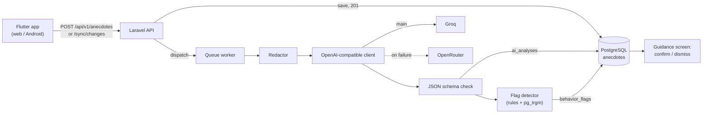
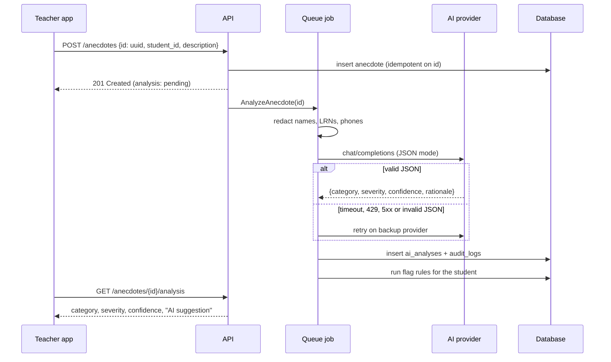

# Integration Design: AI Anecdote Classification and Repeated-Behavior Detection

**System:** Anecnotes · **Milestone:** M2 (Design) · **Status:** draft, 2026-11-23
**Covers:** T1–T6 (technology integration) of the ITSD 85 requirements.

## 1. Purpose

Teachers write anecdotes as free text in English, Filipino or a mix. One student's repeated behavior is spread across several teachers' notes, so the guidance office sees the pattern late. The integration:

1. **Classifies** each anecdote by category and severity (AI).
2. **Flags** a student whose anecdotes repeat within 30 days (rules plus `pg_trgm` text similarity, on top of the AI categories).
3. **Summarizes** a flagged student's anecdotes for the counselor (AI).

A counselor confirms or dismisses every flag. The system never acts on a flag by itself.

## 2. Technology (T1)

| | Demo (this course) | Real school use (recommended) |
|---|---|---|
| Provider | Groq free tier | Local server on the school's machine |
| Backup | OpenRouter free models | — |
| Model | `llama-3.1-8b-instant` (Groq) | Qwen2.5 3B/7B Instruct (Apache 2.0) via llama.cpp or Ollama |
| Data sent | Synthetic, redacted anecdotes only | Real anecdotes never leave the school server |
| Cost | Free | Free (open-weight model, school hardware) |

All three speak the **OpenAI-compatible** Chat Completions API, so one client class serves them. The provider is chosen by configuration, not code:

```
AI_BASE_URL, AI_MODEL, AI_API_KEY                         # main
AI_FALLBACK_BASE_URL, AI_FALLBACK_MODEL, AI_FALLBACK_API_KEY  # backup
AI_TIMEOUT_SECONDS, AI_ENABLED
```

Keys live only in the server's `.env`. The Flutter clients never call a provider; they call the Anecnotes API.

**Why not a local model for the demo:** the demo server is a laptop with a 2-core Intel i5-7200U. A 3B model on that CPU takes tens of seconds per anecdote while Docker also runs the database and API. A one-time comparison run on a small local model (Qwen2.5 0.5B) is still part of the evaluation (section 8).

## 3. Architecture



Saving an anecdote never waits for the AI. The API stores it and returns `201` at once; a queued job (`AnalyzeAnecdote`) does the rest. Offline records are analyzed after they sync.

## 4. Flow



## 5. Redaction (T6, RA 10173)

Before any text leaves the server, the `Redactor` replaces:

| Found | Replaced with | How |
|---|---|---|
| The student's own name (any order, nicknames from first name) | `[STUDENT]` | Names from the `students` row |
| Other enrolled students' names in the section | `[STUDENT_2]`, `[STUDENT_3]`, ... | Names of the section's enrollments |
| Staff names | `[TEACHER]` | `users.name` |
| 12-digit numbers (LRNs) | `[LRN]` | Regex `\b\d{12}\b` |
| Phone numbers | `[PHONE]` | Regex for PH mobile formats (`09xx`, `+639xx`) |
| Email addresses | `[EMAIL]` | Regex |

The placeholder map stays on the server; summaries are shown with names restored only in the counselor's view. The hash of the redacted prompt (`input_sha256`) is logged so an audit can show exactly what was sent. Redaction has its own unit tests, including Filipino name orders ("Dela Cruz, Juan") and names inside words that must not be replaced.

## 6. Prompt contract

### 6.1 Classification

System prompt (abridged; the full prompt is versioned in `backend/resources/prompts/classify.v1.txt`):

```
You classify school anecdotal records written by Filipino teachers in English,
Filipino or both. Return only JSON matching the schema. Use exactly one category:
attendance_tardiness, disruptive_behavior, defiance_disrespect, aggression_bullying,
academic_concern, wellbeing_concern, positive_behavior, other.
Severity: low (minor, one-off), medium (needs follow-up), high (safety risk,
self-harm, violence, abuse). Give confidence 0-1. Rationale: one sentence,
no names. Text is redacted; placeholders like [STUDENT] are not names to guess.
```

Request: `temperature: 0`, `response_format: {"type": "json_object"}`, `max_tokens: 200`.

Expected output, validated against a JSON schema before it is stored:

```json
{
  "category": "aggression_bullying",
  "severity": "medium",
  "confidence": 0.82,
  "rationale": "[STUDENT] pushed a classmate and called him names during recess."
}
```

### 6.2 Summary (flagged student)

Input: the flag's anecdotes (redacted, oldest first, with dates and categories). Output: JSON with `summary` (at most 120 words) and `anecdote_ids` cited per sentence. Shown with the label "AI-generated — verify against the records".

## 7. Repeated-behavior rules

The detector runs after each successful classification for that student. The **final category** is the human override if present, otherwise the AI category. `positive_behavior` never counts.

| Trigger | Rule | Configured by |
|---|---|---|
| `count_rule` | ≥ 3 anecdotes with the same final category within the last 30 days | `FLAG_MIN_COUNT`, `FLAG_WINDOW_DAYS` |
| `similar_wording` | ≥ 3 anecdotes in 30 days whose descriptions are pairwise similar (`similarity() ≥ 0.35`), even across categories, from at least 2 authors | `FLAG_TRGM_THRESHOLD` |
| `high_severity` | Any anecdote with final severity `high` | always on |

At most one `pending` flag per student and category; later matching anecdotes attach to it. When a flag is created, a summary job runs. Rules are plain SQL and PHP, so they still work if the AI is down (with categories from overrides only).

## 8. Fallback and failure handling (T2)

| Situation | Behavior | User sees |
|---|---|---|
| Main provider timeout (> `AI_TIMEOUT_SECONDS`), 429 or 5xx | Retry once on the backup provider | Nothing (analysis appears later) |
| Response is not valid JSON or fails the schema | Retry on the backup provider | Nothing |
| Both providers fail | Job retries with backoff (5 tries over about 2 hours), then marks `failed` | "AI analysis unavailable. The record is saved; analysis will retry." |
| Daily quota exhausted | Jobs wait until the next day (rate-limited queue) | "Analysis pending" |
| `AI_ENABLED=false` | No calls; flags use the count and similarity rules on human categories only | "AI analysis is turned off" |

The anecdote is always saved first, so an AI failure never loses a teacher's note. Rate limiting uses a Laravel rate limiter set below the provider's limits (for Groq, about 30 requests per minute).

## 9. Logging (T3)

Every call writes one `ai_analyses` row and one `audit_logs` row (`action = ai_call`):

| Field | Example |
|---|---|
| provider, model | `groq`, `llama-3.1-8b-instant` |
| outcome | `ok`, `fallback_used`, `failed` |
| category, severity, confidence | `aggression_bullying`, `medium`, `0.82` |
| latency_ms, attempt | `640`, `1` |
| input_sha256 | hash of the redacted prompt |
| requested_by, created_at | user whose action caused the call, server time |

Raw student text is not written to application logs (stderr); only IDs and outcomes are.

Endpoints: `GET /api/v1/anecdotes/{id}/analysis` (current and past analyses) and an admin-only `GET /api/v1/ai/usage` (counts, failures, mean latency per day).

## 10. Evaluation plan (T5, M5)

| Metric | Test set | Target |
|---|---|---|
| Macro F1 over the 8 categories | ≥ 60 synthetic anecdotes written to match local school language, labeled by hand before running the model | ≥ 0.75 |
| Severity accuracy | Same set | reported |
| Flag precision and recall | 10 simulated student timelines (some should flag, some should not) | ≥ 0.80 each |
| Response time | All test calls | mean and 95th percentile reported |
| Comparison | The same set on a local Qwen2.5 0.5B via llama.cpp | reported, not targeted |

An Artisan command (`php artisan ai:evaluate docs/evaluation/ai-testset.csv`) runs the set, writes predictions and a confusion matrix to `docs/evaluation/`, and records provider, model and prompt version. The labels are written before the first run and are not changed afterward.

## 11. Responsible use (T6)

- **Minimal data:** redaction before every call; demo data is synthetic; real use requires the local model.
- **Transparency:** AI output is always labeled "AI suggestion" or "AI-generated", with the confidence shown.
- **Human in control:** teachers can override category and severity; counselors confirm or dismiss every flag with a note; no automatic discipline.
- **Accountability:** every call and every review is in the audit log.
- **Known limits (stated in the user manual):** small models can misread Filipino slang and sarcasm; confidence is the model's own estimate, not a probability; a flag means "look at this student", not "this student did wrong".

## 12. Proof of concept (M3)

- `AiClient` with main and backup provider, JSON validation and logging.
- `POST /api/v1/anecdotes` dispatching `AnalyzeAnecdote`; `GET /api/v1/anecdotes/{id}/analysis` returning the result.
- Pest tests with a fake HTTP provider covering: valid response, invalid JSON, main down and backup up, both down.
