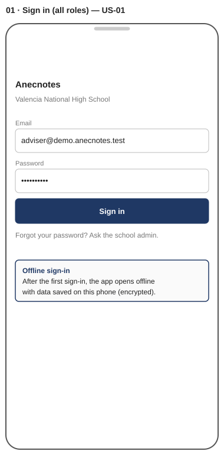
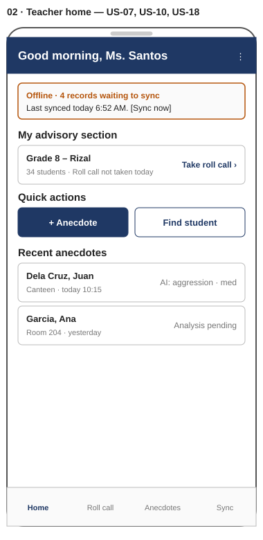
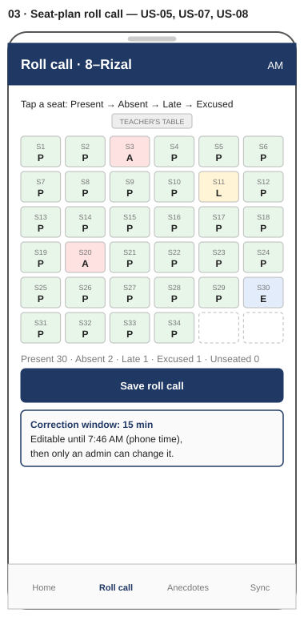
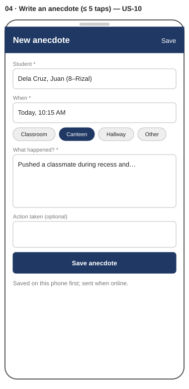
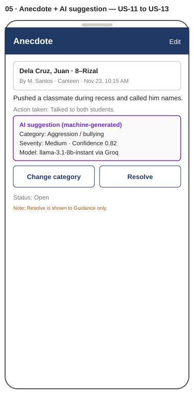
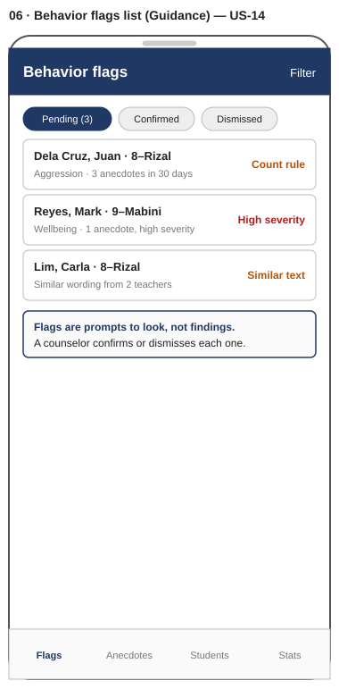
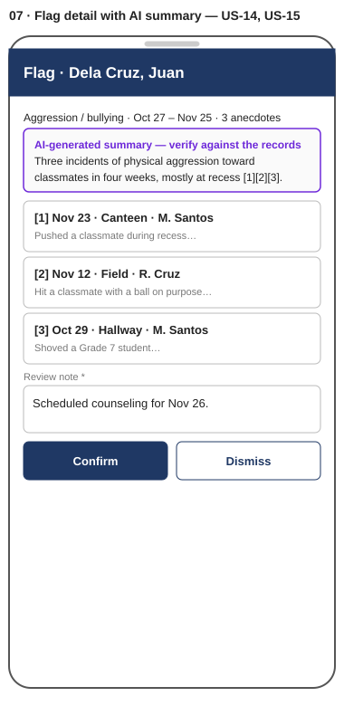
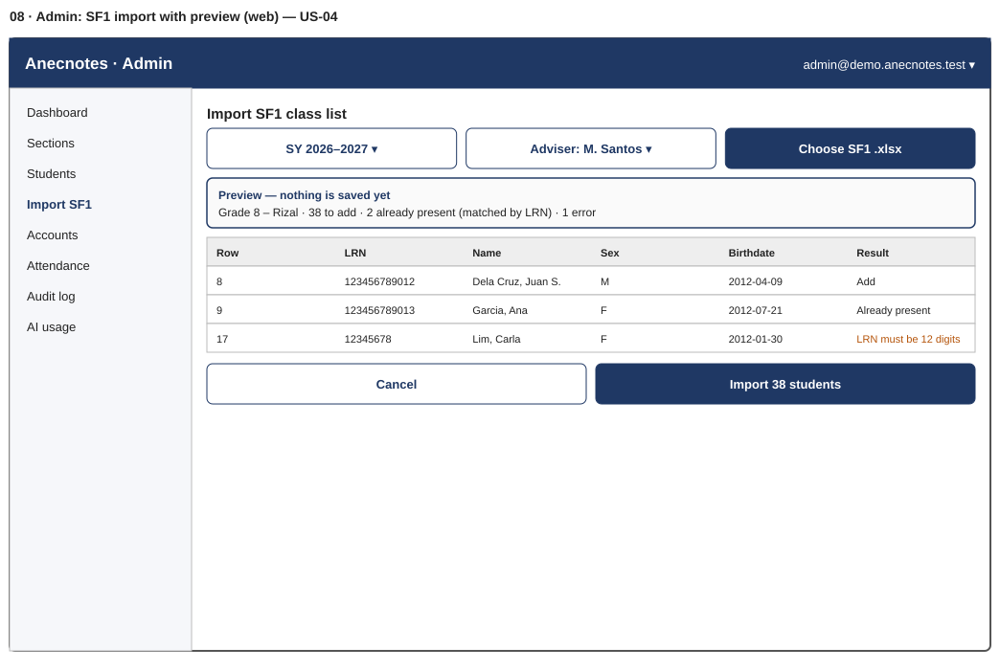
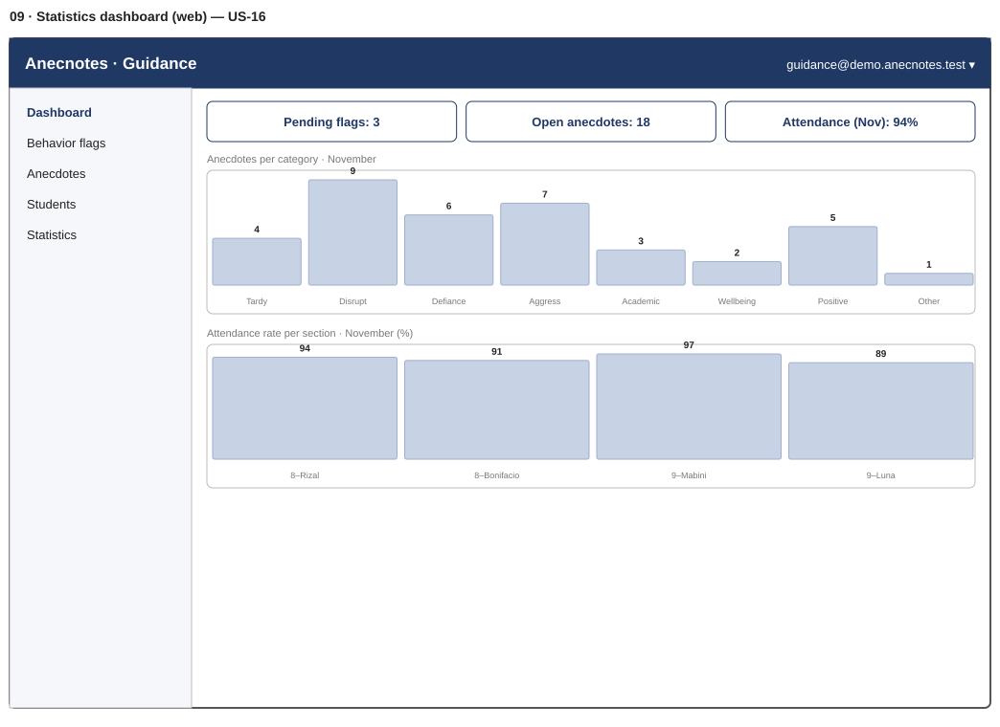

# Wireframes

**System:** Anecnotes · **Milestone:** M2 (Design) · **Status:** draft, 2026-11-23

Low-fidelity wireframes of the main screens. They fix layout, content and flow, not colors or fonts.
Source: [`docs/diagrams/wireframes/build.js`](../../diagrams/wireframes/build.js) — run `node docs/diagrams/wireframes/build.js` to regenerate the SVGs.

Screens 01–07 are the Flutter app on a phone (Android, and the same layout on narrow web windows). Screens 08–09 are the Flutter web app on a laptop. The D2 System Documentation will compare these with the final screens.

| # | Screen | Role | User stories |
|---|---|---|---|
| 01 | Sign in | All | US-01 |
| 02 | Teacher home with sync status | Teacher/Adviser | US-07, US-10, US-18 |
| 03 | Seat-plan roll call with the 15-minute window | Adviser | US-05, US-07, US-08 |
| 04 | Write an anecdote | Teacher | US-10 |
| 05 | Anecdote with AI suggestion | Teacher, Guidance | US-11, US-12, US-13 |
| 06 | Behavior flags list | Guidance | US-14 |
| 07 | Flag detail with AI summary, confirm or dismiss | Guidance | US-14, US-15 |
| 08 | SF1 import with preview | Admin (web) | US-04 |
| 09 | Statistics dashboard | Guidance, Admin (web) | US-16 |

## Phone

| | | |
|---|---|---|
|  |  |  |
|  |  |  |
|  | | |

## Web

## Design notes

- **Roll call in few taps:** everyone starts as Present, so the adviser only taps the exceptions. Seats follow the classroom layout, with the teacher's table at the top.
- **Offline is visible, not hidden:** the home screen shows how many records are waiting and when the last sync happened, with a manual "Sync now" for teachers on paid mobile data.
- **AI output is always labeled** ("AI suggestion (machine-generated)", "AI-generated summary — verify against the records"), shows its confidence and model, and sits next to a human action (change category, confirm, dismiss).
- **Flags are framed as prompts:** the list shows why a student was flagged (count rule, similar wording, high severity), and the detail page shows the anecdotes behind the summary, numbered so each claim can be checked.
- **Imports preview first:** the SF1 import saves nothing until the admin has seen what will be added, what already exists and which rows have errors.
